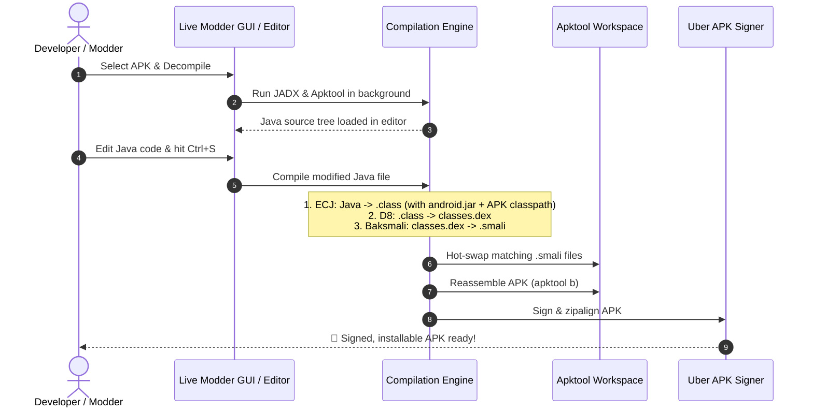

# JADX APK Live Modder

A direct Java code editor and live recompilation bridge for Android APKs.

This tool solves the fundamental limitation of decompilers: **it allows users to view and edit Java source code directly, while in the background it compiles the Java to bytecode, translates it into Smali, hot-swaps it into an Apktool project, and reassembles and signs a working APK.**

---

## ⚡ How It Works Behind the Scenes



---

## 🚀 Quick Start

### Option 1: Desktop GUI
Double-click `run_gui.bat` or run:
```bash
python gui.py
```
1. Click **Browse APK...** and choose your `.apk` file.
2. Click **Decompile & Open**.
3. Select any Java class from the left list.
4. Edit the Java code in the editor.
5. Click **⚡ Save & Rebuild APK** (or press `Ctrl+S`).
6. The final signed APK is saved in the `dist/` folder!

### Option 2: Live Watch Mode (CLI)
If you prefer editing in **VS Code**, **IntelliJ**, or **Notepad++**:
```bash
python cli.py watch your_app.apk
```
This decompiles the APK into `workspace/your_app/java_src/`. Open that folder in your favorite editor. Every time you save any `.java` file, the script will automatically recompile it, patch the Smali code, and output a new signed APK in `workspace/your_app/dist/`!

### Option 3: Manual CLI Patch
```bash
# Decompile
python cli.py decompile your_app.apk

# After editing a file:
python cli.py patch your_app.apk workspace/your_app/java_src/sources/com/example/MainActivity.java
```

---

## 🛠️ Included Automated Toolchain

All necessary helper binaries are automatically downloaded into the `bin/` directory on first run:
- **Eclipse Java Compiler (ECJ 3.33.0)**: Lenient Java compiler with `-proceedOnError` to tolerate decompiled artifacts.
- **Android SDK Stubs (`android.jar`)**: Android platform API definitions for resolving Android classes.
- **Google D8 / R8 (8.2.42)**: Converts compiled `.class` files into Dalvik `.dex` format.
- **Baksmali (2.5.2)**: Converts Dalvik `.dex` into `.smali` instructions for seamless Apktool replacement.
- **Apktool (2.10.0)**: Decompiles and rebuilds the APK package and Android resources.
- **Uber-APK-Signer (1.3.0)**: Cryptographically signs and zip-aligns the final APK with a debug keystore.
- **JADX CLI (1.5.1)**: Decompiles the APK into Java source code.
